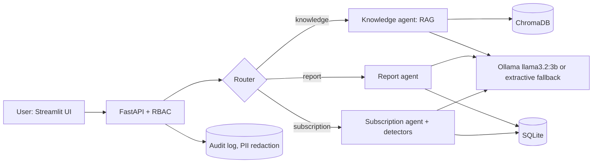

# Nexora AI

*An intelligent business assistant to search, manage and act, powered by RAG and AI Agents.*

Team: Nanthiesh Mohanavel, Dhaval Patel, Ameni Jemai. License: MIT.

> Status: **Phase 0 (foundations)**. Sections marked "not run yet" are filled by scripts in later phases.

## What and why

Nexora AI is a local, multi-agent, RAG-powered assistant for small businesses (1-50 people). It answers questions about internal rules with citations (or refuses), generates weekly/monthly/yearly reports from bank and project data, flags subscription and billing problems, and reads summaries aloud. It is an academic prototype; everything runs on one laptop, for free, offline after a one-time model download. All data is synthetic.

## Canvas

| | |
|---|---|
| **User** | Office manager of a 12-15 person software company |
| **Data** | Synthetic documents, 12 months of transactions, subscriptions, usage, tasks |
| **Metric** | >90% on 15 rule questions; recall >=80% with <=3 false alerts on 20 planted errors; task time -50%; satisfaction >85% |
| **Baseline** | Same LLM without documents; manual review; manual timing |

Full canvas: [docs/scoping-canvas.md](docs/scoping-canvas.md).

## Architecture



## Setup

Requires Python 3.11+ and (optional but recommended) [Ollama](https://ollama.com).

**Windows (PowerShell)**
```powershell
python -m venv .venv
.\.venv\Scripts\Activate.ps1
pip install -r requirements.txt
pip install -e .
python -m scripts.setup_models
```

**macOS / Linux**
```bash
python3 -m venv .venv && source .venv/bin/activate
pip install -r requirements.txt
pip install -e .
python -m scripts.setup_models
```

Without Ollama the app runs in extractive mode (best passage plus citation) and shows a notice.

## Quick start

| Make target | Plain command |
|---|---|
| `make setup` | `python -m scripts.setup_models` |
| `make data` | `python -m scripts.generate_data` |
| `make index` | `python -m scripts.build_index` |
| `make api` | `python -m uvicorn nexora.api.main:app --port 8000` |
| `make ui` | `python -m streamlit run app/Home.py` |
| `make test` | `python -m pytest` |
| `make eval` | `python -m evaluation.eval_rules` and `python -m evaluation.eval_detection` |

(`make` is not installed on Windows by default; use the plain commands.)

## Data, evaluation, results

Not built yet. Results tables will be generated from `evaluation/results/*.json`; until then: **not run yet**.

## Limitations

Synthetic data only; a 3B model can be wrong, which is why answers are cited and refusals are explicit. Details are added after evaluation.

## Roadmap

Phases 1-7: data generator, documents, RAG, agents, API and UI, quality upgrades, evaluation.
