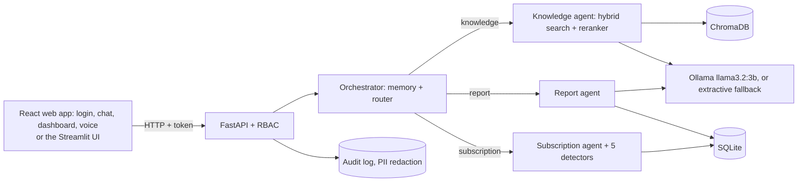

# Nexora AI

*An intelligent business assistant to search, manage and act, powered by RAG and AI Agents.*

An academic business-idea prototype by Nanthiesh Mohanavel, Dhaval Patel and Ameni Jemai.

## What and why

Nexora AI is a local, multi-agent, RAG-powered assistant for small businesses (1-50 people). It

- answers questions about internal rules **with citations**, or refuses when the answer is not in the documents;
- generates weekly, monthly and yearly reports from bank and project data (Python computes every number; the model only words the summary);
- finds problems in software subscriptions and billing: duplicate charges, price increases, unused tools, unlisted charges and overlapping tools;
- reads summaries aloud, and can take questions by voice.

Information in small companies is scattered across documents, spreadsheets and tools, and billing mistakes go unnoticed. Everything here runs on one laptop, for free, offline after a one-time model download: no paid APIs, no API keys, no cloud. All company data is synthetic.

## Canvas

| | |
|---|---|
| **User** | The office manager of a 12-15 person software company (secondary: managers and employees of small businesses with 1-50 people) |
| **Data** | Synthetic company documents, 12 months of bank transactions, subscription and usage logs, project tasks, employees |
| **Metric** | Answer accuracy on 15 rule questions >90%; detection recall >=80% with <=3 false alerts on 20 planted errors; task time -50%; user satisfaction >85%; subscription savings in EUR |
| **Baseline** | The same model without documents; manual review; manual timing |

Full canvas (problem, value, technique, risks): [docs/scoping-canvas.md](docs/scoping-canvas.md).

## Architecture



More detail and design decisions: [docs/architecture.md](docs/architecture.md).

## Setup

Requires Python 3.11+ and, for written answers, [Ollama](https://ollama.com) (free). Without Ollama the app still works in *extractive mode*: it shows the best matching passage with its citation and a notice.

**Windows (PowerShell)**
```powershell
python -m venv .venv
.\.venv\Scripts\Activate.ps1
pip install -r requirements.txt
pip install -e .
python -m scripts.setup_models      # checks Ollama, pulls llama3.2:3b, downloads the embedding and reranker models
```

**macOS / Linux**
```bash
python3 -m venv .venv && source .venv/bin/activate
pip install -r requirements.txt
pip install -e .
python -m scripts.setup_models
```

Optional voice: `pip install -r requirements-voice.txt` (offline text-to-speech and speech-to-text).

**React web app (recommended front end).** Requires [Node.js](https://nodejs.org) 20 or newer. Its dependencies are in `web/package.json`, not in `requirements.txt`:
```
cd web
npm install
```

## Quick start

```
make data docs load index   # synthetic data, documents, SQLite, vector index
make api                    # terminal 1: http://localhost:8000
make web                    # terminal 2: React app at http://localhost:5173
make ui                     # alternative to `make web`: Streamlit at http://localhost:8501
```
Use either front end; both talk to the same API. Without `make`, run `cd web && npm run dev` for the React app.
`make demo` does all of this, runs the tests and starts both servers. `make` is not installed on Windows by default; use the plain commands:

| Make target | Plain command |
|---|---|
| `make setup` | `python -m scripts.setup_models` |
| `make data` | `python -m scripts.generate_data` (seed from `config.yaml`, default 42) |
| `make docs` | `python -m scripts.make_documents` |
| `make load` | `python -m scripts.load_db` |
| `make index` | `python -m scripts.build_index` (re-indexes only changed files) |
| `make api` | `python -m uvicorn nexora.api.main:app --port 8000` |
| `make web` | `cd web && npm run dev` (React app; run `npm install` once first) |
| `make ui` | `python -m streamlit run app/Home.py` (Streamlit app) |
| `make test` | `python -m pytest` |
| `make eval` | the evaluation scripts below |
| `make smoke` | `python -m scripts.smoke_test` (API must be running) |
| ask from the terminal | `python -m nexora.rag.generator "How many vacation days do I get?"` (add `--no-docs` for the baseline) |

**Logging in and registering.** The React app has separate `/login` and `/register` pages. Log in with an email or an employee ID (for example `E001`). All synthetic users share the demo password in `config.yaml` (`auth.demo_password`, stored bcrypt-hashed). Anyone can also create an account with `POST /register` (name, email, password of at least 8 characters); new accounts always get the least-privileged `employee` role, and the role cannot be chosen in the request. Registered accounts live in the same tables as the synthetic employees, so `make load` removes them. Tokens are signed with a secret generated at API start, so restarting the API logs everyone out; set `NEXORA_SECRET` in `.env` to keep sessions across restarts. In the Streamlit app, use the Log in / Register tabs on its start page.

**React app features.** Chat with citations, feedback, typing animation and the extractive-mode banner; read-aloud and voice input (needs `requirements-voice.txt` and microphone permission in the browser); a dashboard with spending, net-result, subscription cost-versus-usage and task charts, data tables, anomalies and confirmable recommendations. The dev server forwards `/api` to the backend at `http://localhost:8000`; to use another backend run `NEXORA_API_URL=http://host:port npm run dev`. A production deployment needs the API and the built app (`npm run build`, output in `web/dist`) behind one reverse proxy, or CORS enabled on the API.

Roles: the Owner and the Operations Manager see everything; the Project Manager sees documents, tasks and project reports but no money data; employees see documents and their own tasks. Access is enforced in the API (HTTP 403), not only in the UI.

Security: role-based access, PII redaction (emails, IBANs, phone numbers) before anything is stored, an audit log of every question, intent, source and action, and a prompt-injection guard that removes instruction-like sentences from retrieved documents. Subscription recommendations are never executed; the "Confirm" button only records a decision in the audit log.

## What you can ask

| Kind | Examples | Who |
|---|---|---|
| Company rules (cited, or a refusal) | "How many vacation days do full-time employees get?", "What was the remote work rule before?" | everyone |
| Spending (computed from the bank data) | "How much did we spend on GitHub last month?", "How much on subscriptions alone?", "How much on travel in March?" | Owner, Operations Manager |
| Income, profit, rankings | "What was our income in March?", "What is our net profit this year?", "What is our biggest expense?" | Owner, Operations Manager |
| Tasks | "How many tasks are blocked?", "Which tasks are overdue?" | everyone (employees see only their own) |
| Headcount | "How many employees do we have?" | everyone |
| Reports | "Give me the monthly report", "weekly report", "yearly report" | Owner, Operations Manager (project manager: tasks only) |
| Subscriptions | "Which subscriptions can we cancel?", "Which tools are unused?", "What does Datadog cost?", "How many people use Slack?" | Owner, Operations Manager |

Amounts, counts and facts are always computed from the data with pandas, never written by the language model. A question that matches none of these gets a message listing what is possible, not an unrelated report. "Last month" means the latest month in the data (2026-10). Free-form questions outside this list are not supported.

## Data

All company data is synthetic and reproducible: the same seed gives byte-identical files. Details are in [docs/data-dictionary.md](docs/data-dictionary.md).

- **Demo company:** Nexora Software Ltd, 15 people, 3 clients, 4 projects.
- **Generated files:** employees, 18 subscriptions, monthly usage, about 1,000 bank transactions over 12 months, 250 tasks, and `ground_truth.json` with **20 planted errors** (5 duplicate charges, 5 price increases, 4 unused subscriptions, 3 unlisted charges, 3 overlapping tools) plus **decoys** that look suspicious but are legitimate.
- **Documents:** 20 company documents in Markdown, Word and PDF, with version, effective date and status (one policy exists as a current and a superseded version).
- **Real data used only as statistics:** amount and payment-day patterns from the public Berka bank dataset, and task lifecycles (type, priority, points, durations, no text or people) from The Public Jira Dataset.

## How evaluation works

Every number below is produced by a script and written to `evaluation/results/*.json`; `python -m scripts.fill_readme` copies the numbers into this file. If something was not run, it says "not run yet". Full protocol, scoring rules and known limits: [docs/evaluation-protocol.md](docs/evaluation-protocol.md).

| Evaluation | Command | What it measures |
|---|---|---|
| A. Rules assistant vs. no-documents baseline | `python -m evaluation.eval_rules [--runs N] [--model qwen2.5:7b] [--semantic-only]` | 15 questions: accuracy, citations, refusals, hallucinations, latency (needs Ollama) |
| B. Detection | `python -m evaluation.eval_detection` | recall, false alerts, precision on 20 planted errors, seeds 42, 7 and 123; savings |
| Retrieval modes | `python -m evaluation.eval_retrieval` | semantic vs. hybrid vs. reranker on development questions |
| C. Time | `python -m evaluation.eval_time record ...` | manual vs. Nexora stopwatch times entered by the team |
| Satisfaction | `python -m evaluation.eval_satisfaction` | thumbs up / down from real users |

## Results

### A. Rules assistant vs. baseline

<!-- BEGIN:rules -->
Model `llama3.2:3b`, temperature 0.0, 3 run(s), run on 2026-11-02. Passed / accuracy are from the first run and the mean over runs.

| System | Passed (run 1) | Accuracy | Citation accuracy | Refusal accuracy | Hallucinations | Mean latency |
|---|---|---|---|---|---|---|
| Nexora (retrieval + refusal) | 14/15 | 93.3% | 91.7% | 100.0% | 0 | 2.9 s |
| Nexora with semantic-only retrieval (before Phase 6) | 13/15 | 86.7% | 83.3% | 100.0% | 0 | 3.0 s |
| Baseline: same model, no documents | 3/15 | 20.0% | n/a | 100.0% | 0 | 2.9 s |

Target: accuracy above 90% (at least 14 of 15) for Nexora: **met** (mean 93.3%, standard deviation 0.000 over 3 run(s)).

| # | Question | Nexora passed | Baseline passed |
|---|---|---|---|
| 1 | How many vacation days do full-time employees get? | yes | **no** |
| 2 | How many unused vacation days can be carried over? | yes | **no** |
| 3 | How many days per week can I work remotely? | yes | **no** |
| 4 | How many approvals does a pull request need? | yes | **no** |
| 5 | Can we deploy to production on a Friday afternoon? | yes | **no** |
| 6 | What is the annual training budget per developer? | yes | **no** |
| 7 | Who must approve an expense above 100 EUR? | yes | **no** |
| 8 | What must happen before we buy a new software tool? | yes | **no** |
| 9 | After how many days of sick leave is a medical certificate required? | yes | **no** |
| 10 | Can I send customer data to my personal email? | **no** | **no** |
| 11 | Within how many minutes must a Sev-1 incident be acknowledged? | yes | **no** |
| 12 | On which day of the month are payslips sent? | yes | **no** |
| 13 | What is the annual bonus structure? | yes | yes |
| 14 | Do we have a four-day work week policy? | yes | yes |
| 15 | What is the office dress code? | yes | yes |
<!-- END:rules -->

### Retrieval modes (development questions)

<!-- BEGIN:retrieval -->
28 answerable and 10 unanswerable development questions (not the 15 evaluation questions); retrieval only, no language model.

| Mode | Right document first | In top 3 | MRR | Unanswerable refused by threshold |
|---|---|---|---|---|
| semantic | 0.82 | 0.93 | 0.88 | 90% |
| hybrid | 0.79 | 0.96 | 0.88 | 90% |
| semantic+rerank | 0.89 | 1.00 | 0.94 | 90% |
| hybrid+rerank | 0.89 | 1.00 | 0.94 | 90% |
<!-- END:retrieval -->

### B. Detection of planted errors, and savings

<!-- BEGIN:detection -->
| Seed | Errors inserted | Found | Recall | False alerts | Precision | Decoys wrongly flagged | Estimated savings (EUR/month) |
|---|---|---|---|---|---|---|---|
| 42 | 20 | 20 | 100% | 0 | 100.0% | 0 | 1,028 |
| 7 | 20 | 20 | 100% | 0 | 100.0% | 0 | 1,060 |
| 123 | 20 | 20 | 100% | 0 | 100.0% | 0 | 1,042 |

Targets: recall >= 80%, false alerts <= 3, precision >= 80%: **met on all seeds**. Thresholds are the `config.yaml` defaults for every seed. The generator and the detectors were built together on synthetic data, so this shows consistency, not performance on real bank data.

| Error type | Found (all seeds) | Recall |
|---|---|---|
| duplicate_charge | 15/15 | 100% |
| overlap | 9/9 | 100% |
| price_increase | 15/15 | 100% |
| unlisted_charge | 9/9 | 100% |
| unused_subscription | 12/12 | 100% |
<!-- END:detection -->

### C. Time saved

<!-- BEGIN:time -->
| Task | Manual (stopwatch) | With Nexora (stopwatch) | Time saved |
|---|---|---|---|
| find_rule | not measured | not measured | not measured |
| monthly_report | not measured | not measured | not measured |
| wasteful_subscriptions | not measured | not measured | not measured |

Target: 50% less time. Values are entered by the team with `python -m evaluation.eval_time record ...`; nothing is estimated.
<!-- END:time -->

### User satisfaction

<!-- BEGIN:satisfaction -->
**not measured** (no thumbs up/down feedback yet; target 85%).
<!-- END:satisfaction -->

## Limitations

- **Synthetic data and small samples.** The documents, the data and the 15 questions were written by the team; 15 questions means one answer moves the score by 6.7 points. Detection scores show consistency with the planted patterns, not accuracy on real bank data.
- **A 3B local model can be wrong or slow.** An answer takes several seconds on a laptop (up to three model calls per message: routing, rewriting, answering). Citations, refusals and the extractive fallback exist because of this. Fixed-wording questions work best.
- **Retrieval misses happen.** On the development questions the right document is not always first; the reranker fixes most but not all cases.
- **Report snapshots.** Task status is a snapshot at the end of the data; blocked and overdue counts for earlier periods use that snapshot.
- **Demo-grade security.** One shared demo password, local tokens, no HTTPS. PII redaction is pattern-based (a German-format amount like `12.345.678` can be mistaken for a phone number).
- **Not yet measured:** task-time savings and user satisfaction need real stopwatch runs and real users (see the tables above).
- **Licences to confirm:** eight documents are adapted from a public employee handbook whose licence has not been verified; the Jira dataset is CC BY 4.0 (credited below).

## Data credits

- Task lifecycles: *The Public Jira Dataset*, Montgomery L., Lüders C., Maalej W., MSR 2022, CC BY 4.0 (https://zenodo.org/records/15719919).
- Background transaction statistics: the public PKDD'99 (Berka) bank dataset. This is real, anonymised data used only as aggregate statistics; no rows are copied.
- Eight documents (code of conduct, complaint policy, sabbatical, new parent leave, other protected absences, drug and alcohol policy, employee privacy, and the structure of the holiday list) are adapted from the public Clef employee handbook. The other twelve are written for Nexora.

## Roadmap

- Connect real data through CSV adapters (bank export, subscription list, project tracker) instead of the synthetic generator.
- Replace the demo login with the company's identity provider; add HTTPS.
- Measure time savings and satisfaction with real users; grow the question set well beyond 15.
- Try larger local models (for example `qwen2.5:7b`) and compare with `--model`.
- Let a person approve a recommendation and apply it in the billing tool (today it is only logged).

## Team

Nanthiesh Mohanavel, Dhaval Patel, Ameni Jemai.

## License

No licence has been chosen yet, so all rights are reserved by the authors. Data and document credits are listed above.
