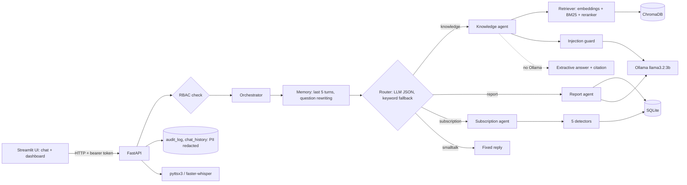

# Architecture

Everything runs locally: a Streamlit UI calls a FastAPI backend, which routes each message to one of three agents. Data lives in SQLite (business data, logs) and ChromaDB (document embeddings). The language model is a local Ollama model; without it the app falls back to extractive answers.

## Layers

| Layer | Code | Responsibility |
|---|---|---|
| Data | `scripts/generate_data.py`, `load_db.py` | Seeded synthetic company data (CSV), loaded into SQLite. Real data only as statistics (Berka bank profile, Jira task lifecycles). |
| Documents | `scripts/make_documents.py`, `rag/loaders.py` | md/docx/pdf corpus with metadata (title, version, effective date, status, owner). |
| RAG | `rag/chunking.py`, `embeddings.py`, `vectorstore.py`, `retriever.py`, `reranker.py`, `generator.py`, `prompts.py` | Section-aware chunks, hybrid search, reranking, strict cited answers, refusal. |
| Detectors | `detectors/*` | Duplicates, price increases, unused tools, unlisted charges, overlaps. Pure functions over pandas frames; thresholds in `config.yaml`. |
| Agents | `agents/*` | Router, memory, knowledge, report (Python computes, LLM only words the summary), subscription (recommendations only). |
| Security | `security/*` | RBAC, PII redaction, audit log, prompt-injection guard, login (bcrypt) and signed tokens. |
| API / UI | `api/*`, `app/*` | Endpoints, dashboard and chat. |

## Decisions worth knowing

- **One chunk per section.** Citations are `[Document title, section]`; merging sections to reach a token target would make the section wrong. Long sections are split with overlap (limit and overlap come from `config.yaml`).
- **The refusal score is always the embedding cosine.** Hybrid fusion and the reranker change the *order*; the best cosine among the returned chunks drives the refusal threshold, so it means the same in every mode.
- **The LLM never calculates.** Report numbers and savings come from pandas. A summary containing a number that is not in the computed data is replaced by a template summary.
- **Documents are data.** Instruction-like sentences are removed from retrieved text before prompting.
- **Recommendations are not actions.** The "Confirm" button only writes an audit record.
- **Fallbacks everywhere.** No Ollama: extractive answers, keyword router, template summaries, and a banner in the UI. No voice packages: voice buttons report that voice is unavailable.
- **Per-request SQLite connections** (`check_same_thread=False` because FastAPI may create them in a worker thread); a connection is never shared.

## Failure messages

Missing data names `make data` / `make load`; an empty index names `make index`; Ollama down or a model not pulled prints the `ollama.com` / `ollama pull` steps; a missing profile or Jira sample names the script that creates it.
